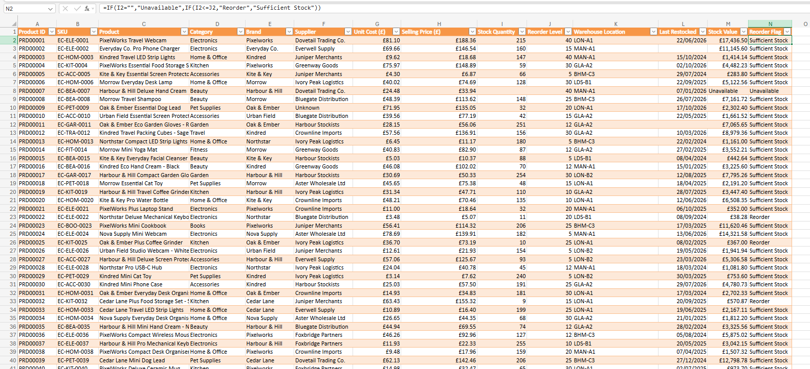
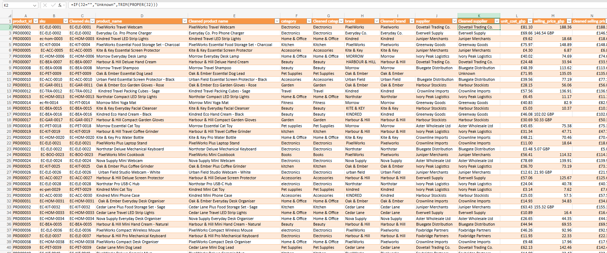
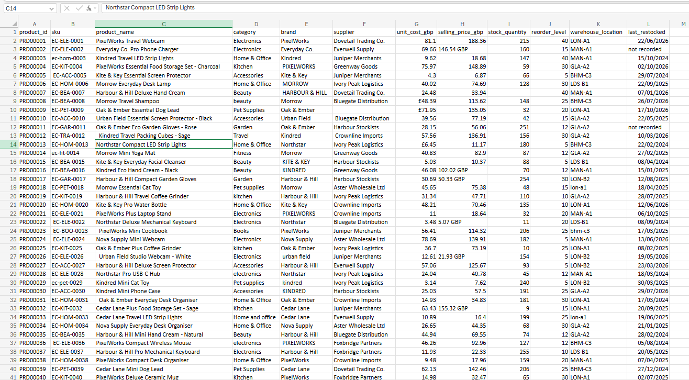

  

# Ecommerce Inventory  

## Contents
- [Purpose](#purpose)  
- [Objectives](#objectives)  
- [Skills](#skills)
- [Specific Skills](#specific-skills)  
- [Previews](#previews)
- [Final Project](#final-project)

## Purpose

The purpose of this project is to demonstrate my data cleaning, data entry and data transformation skills using a mock Ecommerce Inventory dataset.

## Objectives

- Find and remove duplicate values.
- Find and fix missing values and inconsistent values.
- Fix data formatting.
- Create calculated columns using Excel formulas.
- Use a wide range of Excel formulas to edit the data accordingly.
- Standardise data entries across the dataset.
- Ensure data accuracy and integrity.

## Skills
|  |  |
|---|---|
| Excel | Data cleaning |
| Excel formulas | Attention to detail |
| Data validation | Organisation |
| Data formatting |  |
| Data transformation |  |
| Calculated columns |  |

## Specific Skills

| Excel Functions | Excel Skills | Excel Tools |
|---|---|---|
| UPPER | CSV file import | Insert Table |
| TRIM | Data duplication and backup | Data -> Remove Duplicates |
| PROPER | Removing duplicate records | Find & Replace |
| IF | Data cleaning | Paste Special -> Values |
| SEARCH | Text standardisation | Excel Table structured references |
| ISNUMBER | Find and Replace | Excel cell formatting |
| MATCH | Missing value handling | Excel data types |
| INDEX | Conditional logic | Excel formulas and functions |
| IFERROR | Reference list lookups |  |
| VALUE | Error handling |  |
| SUBSTITUTE | Data validation |  |
|  | Data type conversion |  |
|  | Calculated columns |  |
|  | Dynamic Excel table formulas |  |
|  | Data integrity and consistency |  |

## Previews

**Cleaned Dataset**  
  
  
**Working Dataset**  
  

**Original Dataset**  
  
  
## Final Project

[Final Project](Final_Dataset/ecommerce_inventory.xlsx)

###### Original dataset available in repository
